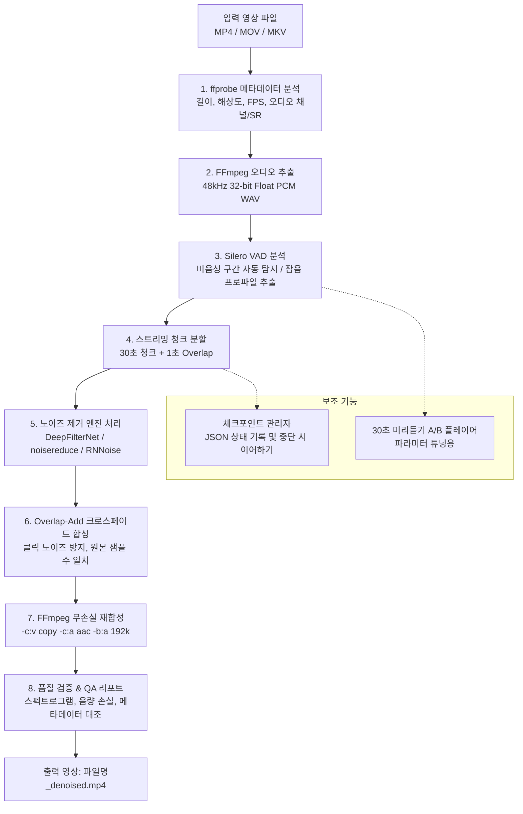

# 화이트 노이즈 제거 데스크톱 프로그램 개발 계획서 (1단계)

## 1. 프로젝트 개요
- **목적**: 로컬 PC에서 동영상 파일(MP4, MOV, MKV, 20~30분, 2.5~3GB 규모)의 비디오 스트림은 무손실 복사(`-c:v copy`)하고, 오디오의 지속적인 화이트 노이즈(마이크 잡음)만 선택적으로 제거하여 AAC 192kbps 이상으로 재합성하는 데스크톱 프로그램 개발.
- **적용 맥락**: 유튜브 채널 영상 제작용 (남성 음성, 상시 일정한 마이크 배경 잡음).
- **원칙**: 원본 파일 절대 수정 금지, 화질 100% 무손실 유지, 상업적 이용(유튜브 수익 창출) 가능한 오픈소스 라이선스만 사용.

---

## 2. 시스템 아키텍처 및 처리 파이프라인



### 상세 파이프라인 단계
1. **메타데이터 분석 (`core/probe.py`)**: `ffprobe`로 영상 길이, 해상도, FPS, 비디오/오디오 코덱, 샘플레이트, 채널 수를 JSON 형태로 파싱하여 기준선(Baseline)을 확보합니다.
2. **오디오 추출 (`core/extract.py`)**: FFmpeg을 사용해 고품질 48kHz, 32-bit float PCM WAV로 오디오 스트림만 무손실 추출합니다.
3. **잡음 프로파일링 (`core/vad.py`)**: Silero VAD를 사용해 음성이 감지되지 않는 순수 배경 잡음 구간(예: 0.5초 이상)을 찾아내어 잡음 스펙트럼 프로파일을 생성합니다. 사용자가 GUI 파형에서 수동으로 구간을 지정할 수도 있습니다.
4. **스트리밍 청크 분할 (`core/chunker.py`)**: 전체 오디오를 한 번에 RAM에 올리지 않고, 30초 단위로 읽으며 앞뒤 1초씩 오버랩(총 31초 또는 32초) 버퍼를 형성합니다. (메모리 8GB 이하 보장)
5. **노이즈 제거 (`core/denoise/`)**: 선택한 엔진(DeepFilterNet, noisereduce 등)으로 청크를 처리하며 노이즈 강도(0~100%)와 음성 보호 강도를 적용합니다.
6. **Overlap-Add 재합성 (`core/chunker.py`)**: Hann 윈도우 기반 크로스페이드를 적용해 경계면 틱/클릭 노이즈와 위상 왜곡을 방지하고, 원본 오디오와 100% 동일한 샘플 수를 맞춥니다.
7. **비디오/오디오 재합성 (`core/extract.py`)**: 원본 영상 스트림은 `-c:v copy`로 단 1프레임도 재인코딩하지 않고 그대로 복사하며, 정제된 오디오는 AAC 192kbps(또는 256kbps/320kbps 선택)로 결합하여 `_denoised.mp4`를 생성합니다.
8. **품질 검증 (`core/qa.py`)**: 처리 전/후 스펙트로그램 이미지 생성, 음성 구간 음량 손실(RMS/dB) 계산(1dB 초과 시 경고), 입력-출력 간 메타데이터(FPS, 길이, 해상도) 완전 일치 여부를 검증합니다.

---

## 3. 디렉토리 및 파일 구조

```
화이트 노이즈 제거 프로그램/
├── main.py                     # GUI 진입점 (PySide6 실행)
├── config.py                   # 전역 설정값 (엔진, 강도, 청크 길이, 코덱, 기본 경로)
├── requirements.txt            # 필요 패키지 의존성 목록
├── setup_env.bat               # Windows 환경 자동 설정 스크립트 (가상환경, PyTorch CUDA/CPU 설치 안내)
├── README.md                   # 프로그램 사용법, 한 줄 실행 명령어, 라이선스 고지
├── PLAN.md                     # 본 계획서 문서
├── core/
│   ├── __init__.py
│   ├── probe.py                # ffprobe 메타데이터 추출 및 일치성 검증
│   ├── extract.py              # FFmpeg 오디오 추출 및 비디오/오디오 재합성 (-c:v copy)
│   ├── chunker.py              # 30초 스트리밍 청크 분할, 1초 Overlap-Add, 체크포인트 관리
│   ├── vad.py                  # Silero VAD 음성/비음성 구간 탐지 및 잡음 프로파일링
│   ├── qa.py                   # 스펙트로그램 생성, 음량 손실 계산, 검증 리포트
│   └── denoise/                # 엔진별 모듈화
│       ├── __init__.py
│       ├── base.py             # BaseDenoiser 추상 기본 클래스
│       ├── deepfilter.py       # DeepFilterNet (DeepFilterNet3)
│       ├── spectral.py         # noisereduce (Spectral Gating)
│       ├── rnnoise.py          # RNNoise / FFmpeg arnndn 래퍼
│       └── enhance.py          # resemble-enhance (선택 옵션)
├── gui/
│   ├── __init__.py
│   ├── main_window.py          # 메인 윈도우 UI (드래그앤드롭, 슬라이더, 상태바)
│   ├── preview_dialog.py       # 미리듣기 (A/B 비교 청취) 다이얼로그
│   ├── worker.py               # 백그라운드 처리 QThread 및 시그널
│   └── widgets/                # 스펙트로그램 캔버스 위젯, 파형 뷰어
├── tests/
│   ├── __init__.py
│   ├── test_chunker.py         # 청크 분할 및 Overlap-Add 샘플 수 무결성 테스트
│   ├── test_extract.py         # 오디오 추출 및 재합성 싱크 테스트
│   └── test_denoisers.py       # 엔진별 기본 입출력 테스트
└── utils/
    ├── __init__.py
    ├── device.py               # GPU (CUDA) / CPU 자동 감지 및 하드웨어 정보
    └── paths.py                # Windows/Mac 한글·공백 안전 경로 유틸리티
```

---

## 4. 선택 라이브러리 및 버전 계획

| 라이브러리 | 권장 버전 | 역할 및 선택 이유 |
| :--- | :--- | :--- |
| **Python** | 3.11.x (또는 3.12) | 최신 딥러닝 휠(PyTorch, DeepFilterNet)과 완벽 호환되는 가장 안정적인 릴리즈 |
| **PySide6** | 6.6.x 이상 | Qt 기반 GUI. Windows에서 드래그앤드롭(QDropEvent), 멀티스레딩(QThread), 반응형 UI가 Tkinter보다 월등히 안정적이며 번들링 용이 |
| **PyTorch & torchaudio** | 2.2.x ~ 2.4.x | DeepFilterNet 및 Silero VAD 추론 엔진. CUDA 가능 시 GPU 가속, 미지원 시 자동 CPU 전환 |
| **DeepFilterNet** | 0.5.6 이상 | 실시간 고품질 딥러닝 음성 향상. 지속적인 마이크 배경 잡음에 탁월한 성능 (1순위 추천) |
| **noisereduce** | 3.0.x 이상 | 스펙트럴 게이팅(Spectral Gating) 방식. CPU 연산만으로 초고속 실행되며, 일정 화이트노이즈 제거에 극도로 강력함 |
| **silero-vad** | 5.1.x 이상 | ONNX/PyTorch 기반 초경량 고정밀 음성 구간 탐지기. 비음성 구간 자동 추출에 활용 |
| **soundfile & scipy** | 최신 안정 버전 | 청크 스트리밍 I/O (`soundfile.blocks`) 및 신호처리 (Hann 윈도우, 필터링) |
| **matplotlib** | 3.8.x 이상 | 처리 전/후 오디오 스펙트로그램 시각화 (GUI 내장 캔버스) |
| **FFmpeg / ffprobe** | 5.x ~ 7.x | 비디오 스트림 무손실 복사, 오디오 추출 및 AAC 192k 인코딩 |

> **GUI 프레임워크 선택 근거 (PySide6 채택)**:  
> Tkinter는 표준 내장 라이브러리이나, Windows에서 드래그 앤 드롭을 지원하기 위해 서드파티 C 확장(`tkinterdnd2`)이 필요한데 종종 DLL 로딩 실패 및 한글 경로 크래시가 발생합니다. 반면 PySide6는 Qt의 강력한 이벤트 루프와 네이티브 드래그앤드롭, 안정적인 백그라운드 QThread, 미려한 다크 테마를 기본 제공하므로 유튜브 영상 작업용 데스크톱 앱에 가장 적합합니다.

---

## 5. 노이즈 제거 엔진 비교표 및 라이선스 확인

| 엔진명 | 라이선스 | 상업적 이용 (유튜브 수익화) | 주 특성 및 강점 | 처리 속도 (RTF) | 하드웨어 요구 |
| :--- | :--- | :--- | :--- | :--- | :--- |
| **DeepFilterNet** (1순위 권장) | **MIT / Apache-2.0** | **가능 (완전 허용)** | 딥러닝 기반 음성 보존 및 지속적 배경 잡음 제거 밸런스 최상 | GPU: ~0.05x (매우 빠름)<br>CPU: ~0.3x (실시간 이상) | GPU 권장 / CPU 가능 |
| **noisereduce** (2순위 권장) | **MIT** | **가능 (완전 허용)** | 비음성 잡음 프로파일 기반 스펙트럴 게이팅. 화이트 노이즈 제거력 탁월 | CPU: ~0.02x (초고속) | CPU만으로 충분 |
| **RNNoise / FFmpeg arnndn** | **3-Clause BSD / LGPL** | **가능 (완전 허용)** | 경량 순환신경망(RNN). 지속 잡음 감소 및 CPU 초경량 작동 | CPU: ~0.01x (극초고속) | 초저사양 CPU 가능 |
| **resemble-enhance** (선택) | **MIT** | **가능 (완전 허용)** | 음질 복원 및 고주파 재생성 (다소 연산량 많음) | GPU: ~0.5x<br>CPU: >2.0x (느림) | GPU 필수급 |
| **Meta Denoiser** | ❌ **CC-BY-NC 4.0** | ❌ **불가 (비상업용 전용)** | **[배제]** 유튜브 채널 상업적 수익 창출 규정에 위배되므로 **코드 및 의존성에서 완전 제외** | - | - |

### 본 프로젝트 타겟 영상에 대한 맞춤 권장
- **사용자 상황**: 마이크 지속 화이트 노이즈, 남성 음성, GPU 모델 미확인 (16GB RAM).
- **기본 모드 추천**: **DeepFilterNet** (GPU가 있으면 극상의 품질과 빠른 속도, 남성 음성의 저음역대 명료도 유지)
- **CPU Fallback / 보조 모드**: **noisereduce** (Silero VAD로 자동 감지한 1초의 비음성 구간을 노이즈 프로파일로 등록 시, 화이트 노이즈만 칼같이 제거되어 CPU 환경에서도 25분 영상을 1~2분 만에 처리 가능)

---

## 6. 핵심 기술 설계 상세

### 6.1. 메모리 8GB 이하 보장을 위한 스트리밍 청크 아키텍처
- 25~30분 48kHz 32-bit Float PCM 오디오는 디스크에서 약 600~800MB이지만, 내부 텐서 변환 및 FFT 연산 시 메모리가 급증할 수 있습니다.
- `soundfile.SoundFile`의 블록 스트리밍 인터페이스를 사용하여 **30초 청크(약 5.7MB) 단위로만 메모리에 적재**합니다.
- 전체 프로세스 메모리 점유율을 **500MB 이하**로 철저히 제한합니다.

### 6.2. Overlap-Add (OLA) 무결성 및 클릭음 방지
- 인접 청크 간 **1초(48,000 샘플) 오버랩**을 부여합니다.
- 경계면에서 Hann 윈도우 기반 가중 합산(Overlap-Add)을 수행하여, 청크 분할로 인한 불연속점(클릭/팝 노이즈)을 수학적으로 완전히 상쇄합니다.
- 출력 오디오의 전체 샘플 수를 원본 입력의 샘플 수와 1 샘플의 오차도 없이 일치시켜 **영상-음성 싱크(AV Sync) 어긋남을 100% 원천 차단**합니다.

### 6.3. 체크포인트 기반 복구 (Resume) 메커니즘
- 작업 시작 시 `work_session_{file_hash}.json`을 임시 폴더에 생성합니다.
- 청크가 1개씩 완료될 때마다 처리된 청크 WAV를 임시 저장하고, 완료 인덱스를 JSON에 원자적(atomic)으로 기록합니다.
- 비정상 종료 후 재실행 시 기존 체크포인트를 감지하여, 이미 처리된 청크는 건너뛰고 **남은 청크부터 즉시 이어하기**가 동작합니다.

### 6.4. 30초 미리듣기 A/B 플레이어
- 영상 전체를 처리하기 전, 사용자가 지정한 30초 구간(예: 05:00 ~ 05:30)만 즉시 처리(약 1~2초 소요).
- 원본 오디오와 노이즈 제거 오디오를 탭 또는 스위치로 실시간 전환하며 A/B 비교 청취할 수 있는 UI 제공.
- 노이즈 제거 강도(0~100%)와 음성 보호 슬라이더를 즉석에서 튜닝한 후 전체 처리를 시작할 수 있도록 워크플로우 구성.

### 6.5. 품질 검증 (QA) 리포트
- **스펙트로그램 시각화**: 처리 전과 후의 주파수 대역별 에너지 변화를 GUI 상에서 시각적으로 확인 (화이트 노이즈 대역이 깨끗해진 모습 표시).
- **음성 구간 레벨 검증**: Silero VAD로 검출된 실제 음성 발화 구간만을 대상으로 처리 전/후 RMS 및 LUFS를 측정하여, 목소리 볼륨이 1dB 이상 깎였을 경우 경고 표시.
- **메타데이터 일치 검증**: `ffprobe`를 통해 출력 파일의 해상도, 프레임레이트(FPS), 재생시간(초 단위 0.01초 이내), 스트림 매핑이 원본과 정확히 일치하는지 자동 검증하여 표로 출력.

---

## 7. 예상 위험 요소 및 대응 방안 (Risk & Mitigation)

| 위험 요소 | 영향 | 구체적 해결 방안 |
| :--- | :--- | :--- |
| **청크 경계의 클릭음/위상 간섭** | 이어붙인 지점에서 뚝뚝 끊기는 잡음 발생 | 1초 오버랩 + Hann 윈도우 Overlap-Add(OLA) 적용. 단위 테스트(`tests/test_chunker.py`)에서 순수 사인파를 통과시켜 재합성 신호의 완벽 복원성 사전 검증 |
| **영상과 오디오의 싱크 밀림 (AV Desync)** | 영상 입모양과 소리가 서서히 맞지 않음 | 원본 오디오의 총 샘플 수(exact sample count)를 정확히 보존하고, FFmpeg 재합성 시 `-c:v copy`와 `-map 0:v -map 1:a` 및 원본 오디오 타임스탬프(`-async 1` 또는 `-copyts`) 옵션을 정밀 제어 |
| **GPU 부재 또는 알 수 없는 그래픽카드** | 프로그램 크래시 또는 속도 저하 | `torch.cuda.is_available()`를 체크하여 CUDA 가속 여부를 감지하고, 없을 경우 CPU 모드로 안전하게 폴백. CPU 감지 시 가벼운 `noisereduce` 또는 CPU 최적화 DeepFilterNet으로 안내 |
| **Windows 한글 및 공백 파일 경로** | FFmpeg 실행 실패 또는 파일 I/O 에러 | `subprocess.run(shell=False)`에 리스트 형태로 인자를 전달하고, 모든 파일 입출력에 `pathlib.Path` 및 UTF-8 인코딩을 강제 적용 |
| **장시간 인코딩 중 메모리 부족 (OOM)** | 3GB 이상 파일 처리 중 프로그램 강제 종료 | `soundfile` 블록 제너레이터를 통한 디스크 스트리밍 청크 처리로 RAM 상주 메모리를 상시 500MB 이하로 엄격 관리 |

---

## 8. 단계별 개발 로드맵

- **[현재 단계] 1단계: 계획서 작성 및 사용자 승인**
  - 계획서 작성 및 기술 스택/라이선스/아키텍처 확정
  - 사용자 피드백 및 승인 획득 후 2단계 착수
- **2단계: FFmpeg 추출, 청크 분할, Passthrough 재합성 구현**
  - `core/probe.py`, `core/extract.py`, `core/chunker.py` 구현
  - 노이즈 제거 없이 오디오를 분할했다가 Overlap-Add로 재합성하여 원본과 길이, 샘플 수, 비디오 싱크가 100% 동일한지 단위 테스트로 검증
- **3단계: 1순위 엔진(DeepFilterNet) 결합 및 3분 샘플 테스트**
  - `core/denoise/deepfilter.py` 구현 및 가속/CPU 분기
  - 3분 샘플 영상 처리 후 스펙트로그램 및 노이즈 제거 품질 확인 및 보고
- **4단계: 추가 엔진, VAD 잡음 프로파일, 미리듣기(A/B) 구현**
  - `noisereduce`(스펙트럴 게이팅), `rnnoise` 엔진 구현
  - `core/vad.py` Silero VAD 연동
  - 30초 미리듣기 A/B 비교 기능 구현
- **5단계: PySide6 GUI, 체크포인트 재개, 최종 품질 리포트 완성**
  - 드래그 앤 드롭 파일 입력, 슬라이더 조절, 실시간 진행률/RTF/남은 시간 표시
  - 체크포인트 저장 및 중단 후 이어하기 기능
  - 품질 검증 스펙트로그램 및 리포트 창 결합
  - `requirements.txt`, `README.md`, 실행 스크립트 작성 및 최종 검증
